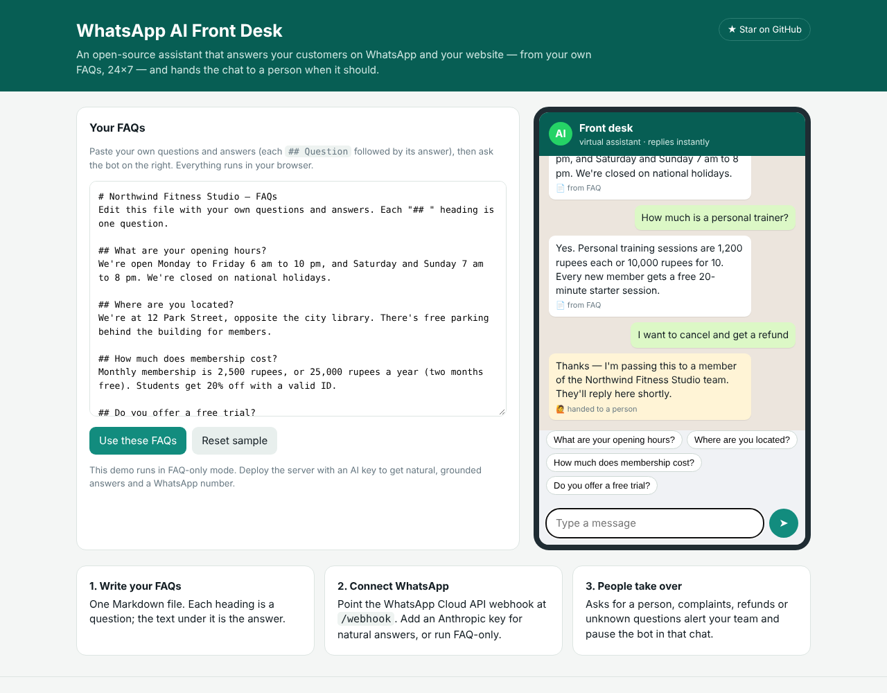

# WhatsApp AI Front Desk

**An open-source assistant that answers your customers on WhatsApp and your website — from your own FAQs, 24×7 — and hands the chat to a person when it should.**

**[▶ Try it with your own FAQs](https://somakant.github.io/whatsapp-ai-front-desk/)** (runs in your browser)



- **Answers only from your FAQs.** One Markdown file is the whole knowledge base. No invented prices or promises.
- **Works without AI.** FAQ-only mode needs no API key. Add an [Anthropic](https://www.anthropic.com/) key and answers become natural and conversational, still grounded in your FAQs.
- **Knows when to stop.** Requests for a person, complaints, refunds, legal or urgent topics, and questions it can't answer go to your team. The bot then stays quiet in that chat so it doesn't talk over your staff.
- **Alerts your team** on Slack, Teams, Discord, Zapier or n8n through one webhook URL.
- **Small and safe.** Zero npm dependencies, Meta signature verification, duplicate-message protection, Docker image.

## Quick start

```bash
git clone https://github.com/somakant/whatsapp-ai-front-desk.git
cd whatsapp-ai-front-desk
cp .env.example .env        # set BUSINESS_NAME, optional keys
npm start                   # Node 20.6+
```

Open http://localhost:3000 to chat with it on the web. Edit `data/faqs.md` with your own questions:

```markdown
## What are your opening hours?
We're open Monday to Friday 9 am to 6 pm.

## Do you deliver?
Yes, within 10 km, free over ₹500.
```

## Connect WhatsApp (Cloud API)

1. In [Meta for Developers](https://developers.facebook.com/), create an app with the **WhatsApp** product and note your **phone number ID** and an **access token**.
2. Deploy this server somewhere with HTTPS (any VPS, Render, Railway, Fly.io, or `docker build -t frontdesk . && docker run -p 3000:3000 --env-file .env frontdesk`).
3. In the app's WhatsApp → Configuration, set the webhook URL to `https://your-domain/webhook`, the verify token to your `WHATSAPP_VERIFY_TOKEN`, and subscribe to **messages**.
4. Set `WHATSAPP_TOKEN`, `WHATSAPP_PHONE_NUMBER_ID` and `WHATSAPP_APP_SECRET` (for signature checks) in `.env` and restart.

Message a test number and the bot replies. WhatsApp's own rules apply: free-form replies are allowed within 24 hours of the customer's last message.

## Configuration

| Variable | Purpose |
|---|---|
| `BUSINESS_NAME` | Used in greetings and hand-off messages |
| `FAQ_FILE` | Path to your FAQ Markdown (default `data/faqs.md`) |
| `ANTHROPIC_API_KEY`, `ANTHROPIC_MODEL` | Optional. Turns on AI answers grounded in your FAQs |
| `HANDOFF_WEBHOOK_URL` | Optional. Gets a JSON alert on every hand-off |
| `HANDOFF_MESSAGE`, `HANDOFF_MUTE_MINUTES` | What the customer sees, and how long the bot stays quiet afterwards (default 240) |
| `WHATSAPP_*` | WhatsApp Cloud API credentials |

## How it decides

```
message → asks for a person / complaint / refund / urgent?  → hand off
        → find best FAQ matches (BM25 search)
        → no AI key: good match? answer it : hand off
        → AI key:    answer ONLY from the matched FAQs, or reply HANDOFF → hand off
```

All of it is in [`src/brain.js`](src/brain.js) (about 50 lines) so you can change the rules.

## API

`POST /api/chat` with `{ "sessionId": "abc", "text": "Are you open today?" }` returns `{ "reply": "...", "mode": "faq" | "ai" | "handoff" | "human" }`. Use it to put the same assistant on your website, app or IVR.

## Roadmap

- [ ] Persistent conversations (SQLite) and a small inbox for staff to reply
- [ ] Booking links and WhatsApp interactive buttons
- [ ] Multilingual FAQs (Hindi, Arabic, Spanish...)
- [ ] Instagram and Facebook Messenger adapters
- [ ] Analytics: top questions, hand-off reasons, unanswered questions to add to the FAQ

Pick one, or suggest your own in [Discussions](https://github.com/somakant/whatsapp-ai-front-desk/discussions). See [CONTRIBUTING.md](CONTRIBUTING.md).

## About

Built by [SK Pokhrel](https://www.linkedin.com/in/somakant), who has run 1,000+ seat contact centres and now builds AI front desks. If this helps your business, please ⭐ the repo so others can find it.

Want it set up and run for you, with your FAQs, WhatsApp number and hand-off to your team? [House of AI](https://housofai.com/?utm_source=github&utm_medium=oss&utm_campaign=whatsapp-front-desk) does exactly that.

## License

[MIT](LICENSE)
